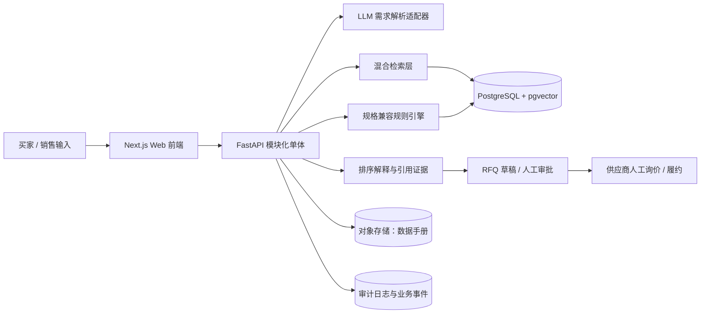

# AI Sourcing Copilot｜系统技术架构 V1.0

**版本** 2026-11-19 / 方案状态：拟议架构，不代表已经生产部署。  
**首个垂直领域** 工业机器视觉组件（工业相机），扩展到镜头、光源、采集卡、线束与工控配件。  
**设计目标** 从“客户表达需求”到“可解释商品候选 + 可审批 RFQ”，而不是先造一个综合商城。

## 0. 架构决策

- **先做模块化单体，不做微服务**：因为未取得客户样本之前，主要风险是需求假设、规格可靠性与商业付费，而不是流量规模。
- **大模型只解释和提取需求，不执行最终合规/兼容判定**：对接口、OS/CPU 架构、版本、阈值和认证要求采用确定性规则与可追溯记录。
- **检索采用混合召回**：关键词/属性过滤 + 向量语义召回，再按可配置硬约束过滤、排序并解释。数据库一开始不必拆成多个专门服务。
- **采购交易人审不可省略**：库存、价格、税费、MOQ、生产资质和交期只有经核验/合同确认后才能对外承诺。
- **所有技术判断必须关联证据**：来源、原始规格书、版本、更新日期、责任人、验证状态和失效时间。

## 1. 端到端组件图



## 2. 生产试点技术选型（首选与备选）

| 层 | 首选 | 选择原因 | 先不做 / 备选 |
|---|---|---|---|
| 客户端 | Next.js + React + TypeScript | 可维护的应用层、表单、国际化与服务端渲染 | 试点仅内部时也可保留原生 HTML 原型 |
| UI | Tailwind CSS + 可访问组件库 | 快速一致的表单、表格和交互 | 避免自研设计系统 |
| API | Python FastAPI + Pydantic | 与模型/数据处理同一语言，自动 OpenAPI、输入校验 | 暂不拆微服务 |
| 主库 | PostgreSQL | 交易实体、多租户与事务一致性 | 演示阶段 SQLite |
| 向量索引 | pgvector | 与 SQL 属性同库，支持 HNSW/混合检索 | 数据量很小先精确检索；暂不引入独立向量库 |
| 关键词 | PostgreSQL Full Text Search + 结构化 SQL | 规范化型号/参数的精确检索 | 中文分词/同义词需要额外配置与评估 |
| 语言模型 | 可替换的结构化输出模型 API | 抽取意图/缺失参数/澄清问题，不直接输出事实承诺 | 无模型情况下规则退化运行 |
| 数据文件 | S3 兼容对象存储 | 数据手册/证书/人工审批证据归档 | 开发用本地文件 |
| 缓存/队列 | Redis（有压力时才加） | 索引/汇率/接口请求等短期缓存 | 初期不用队列系统 |
| 异步业务 | 任务表 + worker | 供应商反馈异步、失败可重试 | 复杂工作流成熟后考虑 Temporal |
| 运维 | Docker Compose → 托管服务 | 可移植、低成本、容易复现 | 不因初期规模引入 Kubernetes |
| 监控 | OpenTelemetry + 结构化日志 | 链路定位、模型成本、审计追踪 | 前期可采用最小日志 |

官方技术依据：[Next.js App Router](https://nextjs.org/docs/app)、[FastAPI](https://fastapi.tiangolo.com/features/)、[pgvector](https://github.com/pgvector/pgvector)、[PostgreSQL FTS](https://www.postgresql.org/docs/current/textsearch-controls.html)。

## 3. 推荐算法架构

### 3.1 解析

输入：自然语言文本、数量、目的地与业务来源。输出 JSON Schema：

```json
{
  "application": "高速检测",
  "mandatory": {
    "interface": "USB3",
    "shutter": "global",
    "sdk_os": "Linux",
    "sdk_arch": "arm64",
    "min_mp": 2,
    "min_fps": 120,
    "max_unit_price_usd": 320
  },
  "quantity": 20,
  "uncertainties": ["镜头接口未指定", "Linux SDK 具体版本未指定"],
  "extraction_method": "llm_or_rule",
  "needs_human_confirmation": true
}
```

**强制规则：** 模型解析出的硬性需求必须显示给用户确认。缺少关键参数时澄清，不能猜测。结构化参数采用类型及单位规范化（MP、fps、USD、毫米等）。

### 3.2 候选召回

- 先使用 SKU/型号精确匹配、品类及接口属性过滤；
- 用全文检索解决型号、标准和关键描述；
- 用向量索引检索相似应用场景和说明书文本；
- 用 RRF 或经离线数据验证的融合方法合并候选；
- 在拥有真实采购日志后才训练/校准权重。

### 3.3 硬约束判定（Fail Closed）

- `接口 / 协议版本 / Linux 架构 / 快门类型 / 帧率 / 分辨率 / 单价上限 / 认证地区` 属硬约束；
- 失败候选直接拒绝，显示准确原因；
- `未知 / 过期 / 供应商资料冲突` 进入待核实，不可标为“满足要求”；
- 每个判断存规则版本、证据 ID、参与运算的原始值；
- 只有满足硬约束者才能进入偏好排序。

### 3.4 排序与解释

在合格集内按总采购成本估算、交期、供应商真实履约记录、参数冗余和客户偏好排序。权重需要可配置。分数永远不是“兼容性百分比”或真实价格准确度。演示版使用纯规则启发式，没有学习模型和向量库。

## 4. 关键数据实体

- `buyers` 采购企业和身份（租户隔离，生产版）。
- `requirements` 原始需求、结构化约束及确认版本。
- `products` SKU 主表：型号、规格、接口、支持 OS/架构。
- `product_documents` 数据手册、适用固件/SDK、证据来源和有效期。
- `compatibility_edges` 组件关系图：设备—镜头、SDK—OS—CPU、接口—线束。
- `suppliers` 工厂/贸易商身份、授权、资质、供货能力。
- `supplier_offers` 正式报价、货币、MOQ、数量阶梯、价格有效期、Incoterms。
- `matches` 每一次匹配的候选和失败原因、规则版本。
- `rfqs` 询价单，`rfq_lines` 明细、`rfq_events` 审批/发送/回复/版本。
- `audit_events` 敏感业务动作及人工覆盖的审计日志。

试点可用 PostgreSQL + jsonb 保存变化快的扩展规格，稳定通用字段规范化入表。`schema.sql` 给出基础实体设计。

## 5. API 与集成边界

| API | 用途 | 演示状态 |
|---|---|---|
| `POST /api/parse` | 从文本生成可编辑约束 | 规则实现，非 LLM |
| `POST /api/match` | 多约束过滤 + 排序 + 排除原因 | 可运行 |
| `GET /api/products` | 返回演示目录 | 可运行 |
| `POST /api/rfqs` | 创建**草稿** RFQ | 可运行，SQLite |
| `GET /api/rfqs` | 查看本地服务保存的草稿 | 可运行 |
| `POST /v1/rfqs/{id}/approve` | 审批询价单 | 生产目标，未实现 |
| `POST /v1/suppliers/{id}/request-quote` | 发送经批准询价 | 生产目标，未实现 |
| `POST /v1/documents/ingest` | 解析数据手册和证据审核 | 生产目标，未实现 |

## 6. 最基本的安全和合规约束

- 供应商 API/邮箱账号服务端存储，不进入浏览器；敏感配置使用密钥管理。
- 买家资料按组织与岗位最小权限控制；完整请求按业务需要设置保留期限；日志脱敏。
- 模型输出始终视为不可信建议，不允许它直接调用支付、下单或承诺价格 API。
- 商品和认证数据必须记录原始来源、授权范围及更新日期，不能把爬取的第三方资料自动视为可商用。
- 外发报价和合同必须经过指定负责人审批；交易涉及 HS 编码、进口合规、关税、出口管制和售后责任，按目的地逐项核实。

## 7. 性能与质量指标（目标，而非实测）

| 指标 | 首轮验收目标 | 验证方式 |
|---|---|---|
| 关键硬约束误放行 | 0 / 约定测试集 | 构建至少 100 个带标注案例 |
| 有答案的检索命中率 | Recall@20 ≥ 95%（目标） | 标注查询与标准答案 |
| P95 匹配 API 时延 | ≤ 2s（目标，不含外部询价） | 标准化并发压力测试 |
| 外发报价人工审核 | 100% | 审计日志抽样 |
| 每一条推荐有解释及证据 | 100% | UI/API 自动检查 |
| 采购方认同推荐可用 | 试点后评估 | 客户盲测 / 业务访谈 |

## 8. 三阶段交付门槛

**Phase 0 / 现在：** 用户可点击的 Demo，完全虚构数据，证明交互逻辑和约束门槛。  
**Phase 1 / 有偿 PoC：** 拿到买家真实授权目录和历史 RFQ，建立标准化字段和版本规则，在客户服务器或隔离环境测试。  
**Phase 2 / 真正交易：** 接入真实供应商报价、权限控制、人工审批、正式履约与合同数据。此后才讨论全面 Agent 自动化。

## 9. 不采用的架构（暂时）

不使用多智能体自由协商代替确定性规则；不自建基础大模型；不在缺少检索数据的情况下把 pgvector 当成护城河；不在没有真实需求和付费验证时构建跨行业大型平台。